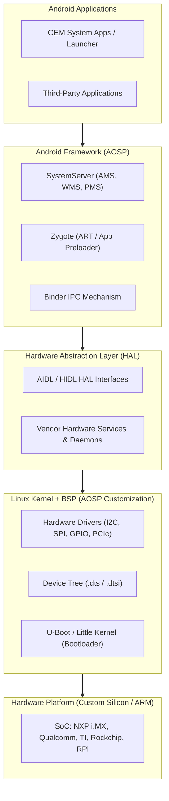
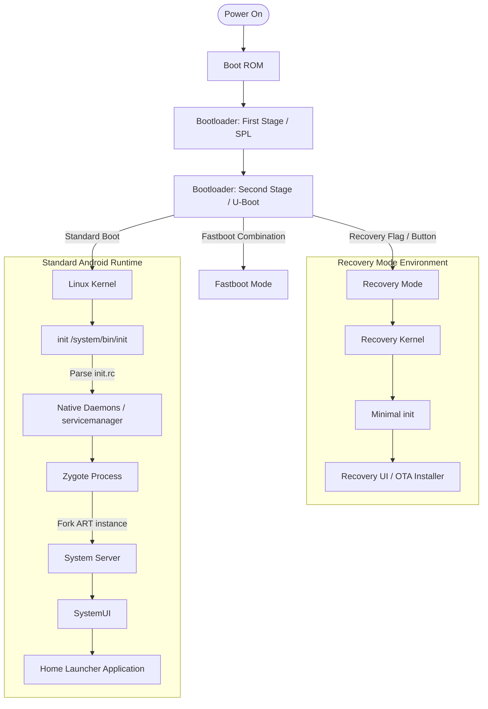
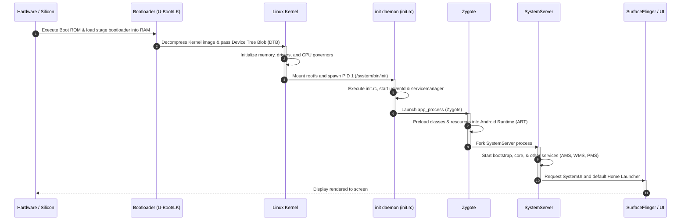

# Embedded Android 

---

---

## 1. Architectural Overview

Embedded Android bridges lower-level board support packages (BSPs) with the rich application runtime of Android.

---

## 2. End-to-End Boot Sequence

### Boot Flowchart
The Android boot flow follows an exact progression from internal chip ROM to the default system launcher, branching out into alternate diagnostic/recovery modes when requested.

---

### Boot Timeline & Sequence

---

## 3. Core Engineering Roadmap

| Phase | Topic | Covered Concepts | Real-World Application |
|---|---|---|---|
| **01** | **Linux Basics** | `init`, `systemd`, file permissions, rootfs hierarchy | Foundational for all embedded platforms. Navigating terminal, debugging sysfs/procfs, modifying rootfs. |
| **02** | **Android Architecture** | Zygote, Binder IPC, `SystemServer`, native services | Customizing system components, intercepting app lifecycles, understanding cross-process IPC. |
| **03** | **Boot Process** | Boot ROM, SPL/U-Boot, `init`, `init.rc`, boot triggers | Board bring-up, optimizing boot times, writing custom startup scripts and daemons. |
| **04** | **AOSP Structure** | `/system`, `/vendor`, `build/`, `device/`, `frameworks/` | Navigating multi-gigabyte source trees, building custom ROMs, managing proprietary vendor blobs. |
| **05** | **Build System** | `Android.mk`, Blueprint (`.bp`), Soong, Ninja, Build targets | Compiling custom system libraries, adding HAL modules, generating `userdebug` vs `user` images. |
| **06** | **HAL & AIDL / HIDL** | AIDL-for-HALs, Stable Binder, interface definitions | Interfacing custom peripherals (sensors, biometrics, CAN bus) with high-level framework services. |
| **07** | **BSP & Device Tree** | DTS/DTSI files, U-Boot environment, Kernel configs | Board bring-up for custom SoCs (NXP i.MX, Rockchip, Raspberry Pi), pinmuxing, power tree configuration. |
| **08** | **Flashing & Partitions** | Fastboot, Recovery, ADB, Partition tables (`super.img`) | Flashing custom images to hardware, debugging low-level board states, managing dynamic partitions. |
| **09** | **Debugging Tools** | ADB, Logcat, `dmesg`, Systrace/Perfetto | Diagnosing boot loops, kernel panics, HAL interface crashes, and frame drops. |

---

## 4. Advanced Embedded Android 

### Custom System Services
To connect unique hardware to standard applications, engineers introduce custom system services:
1. Define interface rules using **AIDL**.
2. Implement backend service logic in `frameworks/base/services/core/java/` (or native C++).
3. Register the service inside `SystemServer.java` via `ServiceManager.addService()`.
4. Provide a public or `@SystemApi` manager client within `frameworks/base/core/java/android/app/`.

### OTA & Dual-Slot (A/B) Updates
Modern embedded platforms (Automotive, IoT, Kiosks) utilize **Seamless A/B Partitioning**:
* Physical storage holds two boot/system slot configurations (`_a` and `_b`).
* An active OS on Slot A writes new image payloads into Slot B in the background while the user operates the device.
* The boot control HAL flags Slot B as `bootable` and sets it for the next reboot.
* The bootloader attempts to start Slot B:
  * **Success:** Slot B is marked `successful`.
  * **Failure (Boot loop / crash):** Hardware watchdog or boot count limit triggers an automated fallback to Slot A, preventing field bricking.

### Platform Security & Hardening
* **SELinux (Security-Enhanced Linux):** Android runs SELinux in **Enforcing mode**. Every native binary and HAL must have a dedicated security domain, type definitions, and explicitly granted `allow` rules in `.te` (Type Enforcement) policy files.
* **Android Verified Boot (AVB) & dm-verity:**
  * Establishes a cryptographic root-of-trust from the bootloader to the kernel.
  * Employs hash trees (`dm-verity`) to continuously validate the integrity of read-only partitions (`system`, `vendor`, `product`). If unauthorized modifications occur, the partition is rejected.

### Production Engineering
* **Image Optimization:** Stripping unused framework features, using ProGuard/R8, disabling unused native daemons to trim image size for flash memory constraints.
* **Build Variants:**
  * `eng`: Development build (root enabled, default ADB active, debugging flags).
  * `userdebug`: Production-like system retaining root access and debug instrumentation.
  * `user`: Sealed production image (root disabled, ADB off by default, AVB enforced).

---

## 5. Technical Correctness & AOSP Notes

1. **AIDL vs. HIDL Migration:**
   * Modern AOSP (Android 11 onwards) has officially **deprecated HIDL** in favor of **AIDL for HALs**. 
   * AIDL provides a single, unified IPC runtime across the entire stack (App $\leftrightarrow$ Framework $\leftrightarrow$ HAL), replacing HIDL's separate `hwservicemanager` with standard `servicemanager` registration.
2. **Dynamic Partitions:**
   * Starting with Android 10, physical storage partitions (`system`, `vendor`, `product`, `odm`) are typically grouped inside a single dynamic physical partition named **`super`**.
3. **Init System:**
   * While traditional desktop Linux distros use `systemd`, Android utilizes its own proprietary `init` process optimized for low-latency bootup, driven strictly by `*.rc` (runtime configuration) files.