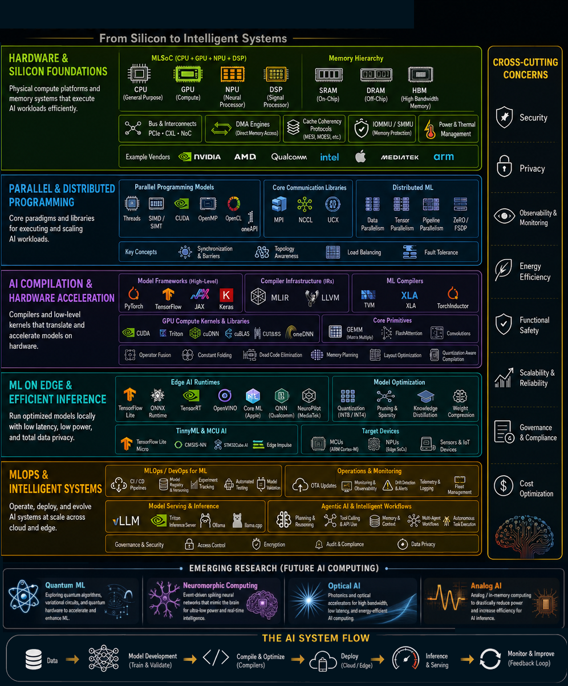

| Category | Typical Location | AI Workload | Example Technologies |
| :--- | :--- | :--- | :--- |
| **Edge / Embedded AI** | MCU, SoC, NPU, DSP, GPU | Real-time inference close to the sensor/device | TensorFlow Lite, ONNX Runtime, TensorRT, Qualcomm AI Engine, ARM Ethos |
| **Cloud AI** | Data center / GPU cluster | Large-model training and inference | CUDA, Kubernetes, GPUs, distributed systems |
| **On-device AI** | Smartphone, vehicle ECU, wearable, camera | Low-latency inference, often offline | NPU/DSP/GPU, quantized models |
| **AI-enabled software** | Application/server | LLMs, recommendations, analytics, agents | Python, APIs, vector DBs, LLMs |
| **AI infrastructure** | Servers/data centers | Scheduling, GPU management, virtualization, inference infrastructure | Kubernetes, KVM/QEMU, vSphere, GPUs, distributed systems |

